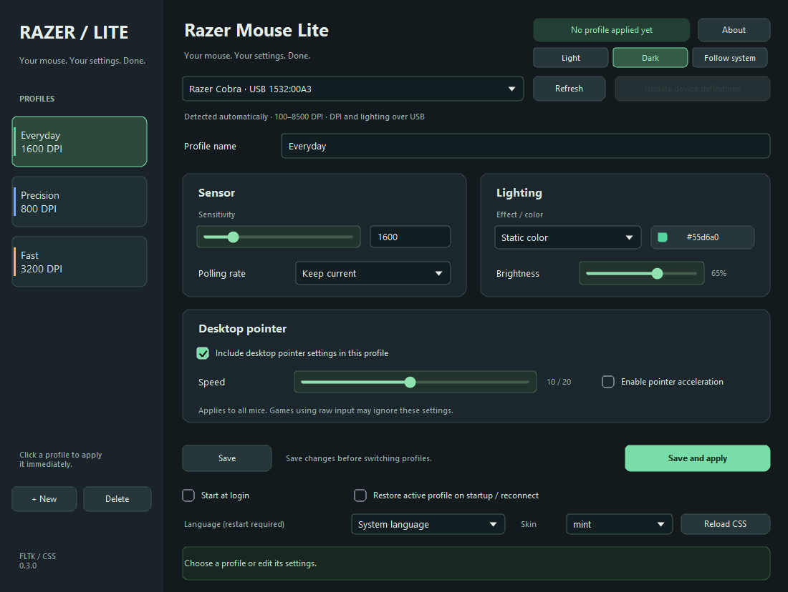
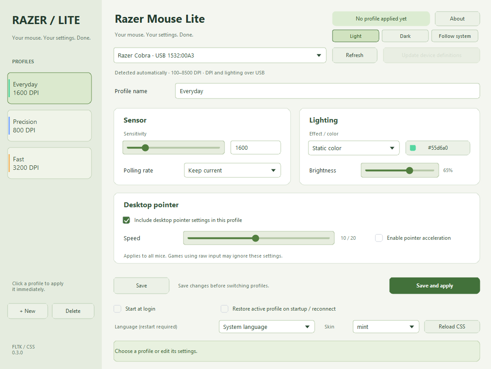

# Razer Mouse Lite

**Your mouse settings should not need a software suite.**

A focused, unofficial Razer mouse settings app for Windows and Linux, written in
C++17, FLTK and the fltk-css styling library. Set your DPI, choose a color, save a profile, and get back to
what you were doing.

[Downloads](https://github.com/hdijkema/razer-mouse-lite/releases) ·
[Builds and tests](https://github.com/hdijkema/razer-mouse-lite/actions/workflows/build.yml) ·
[Report an issue](https://github.com/hdijkema/razer-mouse-lite/issues)

## Why this exists

If all you want is a different DPI, pointer acceleration, or a less distracting
LED, a large peripheral-management suite can feel like a lot of software for a
small job. Razer Mouse Lite keeps that job small:

- One settings window and local profiles.
- A tray menu for switching profiles.
- No account, cloud sync, advertising, promotional pop-ups, or telemetry.
- No webview, bundled browser, background service, or Python runtime.
- No background update checks. Device definitions are downloaded only when you
  click **Update device definitions**.
- Start at login only if you enable it. Restore your last profile only if you enable that too.

This is the kind of frustration people describe in Reddit discussions about
[large downloads and internet access just to change DPI](https://www.reddit.com/r/razer/comments/188uucx/to_change_the_dpi_settings_of_my_new_razer_mouse/),
[advertisements inside Synapse](https://www.reddit.com/r/assholedesign/comments/15x6ub0/they_added_ads_into_my_mouse_software_razer/),
and [unwanted extras when adjusting mouse settings](https://www.reddit.com/r/razer/comments/1gr3563/razer_snypase_breaking_my_mouse/).
These are individual users' reports about particular versions and setups, not
benchmarks or a claim that every current Synapse installation behaves the same way.

The app uses the C++ standard library and the header-only nlohmann/json parser.
FLTK and fltk-css are statically linked in application builds. There is no Qt,
web engine, translation compiler or runtime JSON dependency. No performance
comparison with Synapse is claimed without measurements.

## What you can do

| Setting | What the app provides |
| --- | --- |
| DPI | One sensitivity value per profile, applied to both axes |
| Polling rate | Keep the current value, or select 125 / 500 / 1000 Hz on supported models |
| Desktop pointer | Speed and acceleration; availability depends on the operating system |
| Lighting | A static color, brightness, off, or keep the current lighting |
| Profiles | Create, edit, save, delete, and apply with one click |
| Tray | Left-click for the next profile, double-click for settings, right-click for the menu |
| Startup | Separate checkboxes for starting at login and restoring the active profile |

The app communicates directly with the mouse through native HID APIs. Synapse
and an OpenRazer daemon are not required. Close other mouse-control software
before applying settings so the applications do not overwrite each other.

Macros, button remapping, per-game automation, firmware updates, surface
calibration, RGB animation editors, and programming the physical DPI button's
stages are outside the current scope.

## Download and use

### Windows x64

Open [Releases](https://github.com/hdijkema/razer-mouse-lite/releases) and choose:

- **`razer-mouse-lite-<version>-windows-x64-setup.exe`** for installation.
- **`razer-mouse-lite-<version>-windows-x64.zip`** for a portable copy.

The installer offers **just me** and **all users**. Only the all-users option
requires administrator rights. The ZIP includes the required MSVC runtime and editable CSS skins; extract the whole folder and run `razer-mouse.exe`.

No release listed yet? Successful runs on the
[Actions page](https://github.com/hdijkema/razer-mouse-lite/actions/workflows/build.yml)
provide downloadable build artifacts.

1. Connect your mouse over USB. It is detected automatically.
2. Select a profile, adjust the settings, and choose **Save and apply**.
3. Click another profile to apply its saved settings immediately.
4. Optionally enable **Start at login** and **Restore active profile on startup / reconnect**.

**Save** stores a profile without applying it. Save edits before switching
profiles. Closing the window hides it in the tray; choose **Quit** in the tray
menu to exit. On desktops without tray support, closing the window exits the app.

The autostart setting belongs to the current Windows user, even with an all-users
installation. For a portable copy, put the folder in its final location before
enabling autostart. After moving it, switch autostart off and on to update its path.

### Linux

The workflow produces separate packages for **Ubuntu 24.04 x86-64** and
**Debian 13 (Trixie) amd64**. Choose the package matching your distribution:

- Ubuntu: `razer-mouse-lite-<version>-linux-x86_64.deb`.
- Debian 13: `razer-mouse-lite-<version>-debian13-amd64.deb`.

The Debian package is built and tested inside a Debian 13 container, including
installation and an installed-app startup check. Install your downloaded package
with `sudo apt install ./razer-mouse-lite-<version>-debian13-amd64.deb`.

Other distributions can build from source. Linux support uses `libudev` and
`hidraw`; physical Linux mouse testing is still needed in addition to CI.

The supplied udev rule grants the active local desktop session access to known
Razer mouse models. See [Linux setup](docs/BUILDING.md#linux) for installation.
Run the app as your normal user.

On X11, desktop pointer speed and acceleration use the optional `xinput` utility
and apply to the selected libinput mouse. On Wayland, those controls are disabled:
your desktop/compositor manages them. DPI, polling, and lighting are independent
of that limitation. On Windows, desktop pointer settings affect all mice.
Games using raw input may ignore desktop pointer settings.

## Device support and current limits

The wired **Razer Cobra, USB `1532:00A3`**, is the hardware reference for this
project: 100–8500 DPI, static lighting, brightness, and 125/500/1000 Hz polling.
The Windows backend has been exercised with this mouse, including reading its
current DPI. Automated packet tests also check its exact protocol messages.

The bundled database describes **over 100 USB mouse models** derived from OpenRazer
and openrazer-win. A database entry does **not** mean that every feature has been
verified on that model. Bluetooth is not supported.

**Update device definitions** checks this project's published, converted mouse
database on GitHub. Compatible changes are stored locally and take effect without
reinstalling the app. Downloads are checked before installation; an invalid,
unsupported or failed download leaves the current definitions in place. Updating
definitions does not apply a profile or send settings to the mouse.

OpenRazer is the original source of the device knowledge. Its definitions live in
C driver code and Python device classes, rather than a standalone `mice.json`.
Our database is converted from openrazer-win's OpenRazer-derived data, not a file
distributed by OpenRazer itself. New protocol behaviour still needs an app update.
The app works offline; this optional button contacts GitHub only when requested.

A weekly GitHub Action checks OpenRazer's mouse-related source files. Relevant
changes are converted and tested; only changed definitions produce a draft update
PR. Nothing is merged or published automatically. This picks up fixes for existing
mice as well as new models, without making an update PR for every upstream commit.

If a command fails, the app reports the error rather than marking the profile as
successfully applied. Earlier hardware commands may already have taken effect;
there is no automatic hardware rollback.

When reporting a device issue, include the model, USB product ID, connection type,
operating system, and the error shown in the app.

## Languages and local data

English, Dutch, German, Danish, Norwegian Bokmål, Swedish, French, and Spanish are
included. The app follows your system language, with English as the fallback.
Choose a different language in settings and restart the app to apply it. Translation catalogues are embedded JSON; Qt Linguist is not required. Existing
profile names are your own text and are not translated. Native system dialogs may
follow the operating system's language.

Profiles are stored locally as JSON:

| Platform | Default location |
| --- | --- |
| Windows | `%LOCALAPPDATA%/MouseLite/MouseLite/profiles.json` |
| Linux | `~/.config/MouseLite/MouseLite/profiles.json` |

The historical `MouseLite` storage name is retained so upgrades keep existing
profiles. Saves use atomic file replacement. A corrupt profile file is reported
and is not silently overwritten. The installer and uninstaller preserve profiles.

## Appearance and skins

Use **Light / Dark / Follow system** at the top of the window. Changes apply
immediately and are saved. Follow system reads the Windows app theme or the
Linux desktop portal preference and tracks subsequent changes; a desktop that
provides no preference uses light mode.

Three editable templates are included: **Mint**, **Graphite**, and **Sand**, each
with a `light.css` and `dark.css`. Select a skin beside the language selector.
**Reload CSS** reads your edits without restarting; an invalid stylesheet leaves
the last working style intact and displays the parser error.

Copy an existing skin directory to create your own. Skin directories are read
from `<settings folder>/skins`, then `skins` beside the executable, then the Linux
installation's `share/razer-mouse-lite/skins`. User overrides take precedence.
The built-in templates are also embedded so the app starts when external CSS
files are unavailable. Geometry stays in FLTK; CSS controls appearance and fonts.

## Tray integration

Windows uses the native notification area. On Linux, AppIndicator/GTK3 is loaded
at runtime using `dlopen`; no development package or GTK linkage is needed to
build. Debian/Ubuntu users can install `libayatana-appindicator3-1`. The desktop
must also provide an indicator host (some GNOME desktops require an extension).
The DEB recommends the runtime package; the executable works without it.

With a working tray, closing the window hides it. Without one, closing exits.
Windows supports click for the next profile and double-click for settings.
On Linux, use the profile menu and **Next profile**; older AppIndicator versions
open their menu on primary activation. This follows the platform-specific
approach used in the author's `racket-tray` library.

## Build, test, and release

See [BUILDING.md](docs/BUILDING.md) for Windows and Linux dependencies, local
builds, editable skins, Inno Setup packaging, testing, and GitHub Actions.

Windows builds have been verified locally. Linux CI definitions build Ubuntu and
Debian 13 with Xvfb for UI rendering tests. macOS needs its own HID/pointer/startup
backend; a native AppKit `NSStatusItem`/`NSMenu` tray can fit behind the existing
platform interface, as in `racket-tray`. This version does not ship a macOS build.

A numeric tag such as `v0.3.0`, or a manual workflow run with a version, publishes
a GitHub Release only after all platform jobs succeed. Ordinary branch pushes
do not publish a release.

You can also create a release on GitHub with a tag such as `v0.3.0` and click
**Publish release**. This builds the tagged commit and attaches the Windows ZIP,
Windows installer, Ubuntu DEB and Debian 13 DEB to that release after all jobs
succeed. Saving a draft does not start a build. The tagged commit must contain
this workflow; versions use `X.Y.Z` or `vX.Y.Z` without suffixes.

## Credits and license

Razer Mouse Lite is independent and is not affiliated with or endorsed by Razer.
Razer and Synapse names and the reused Synapse icon belong to Razer; the icon is
not covered by this project's GPL license.

The code is **GPL-2.0-or-later**. Device/protocol information is adapted from
[OpenRazer](https://github.com/openrazer/openrazer) and
[openrazer-win](https://github.com/Ar4ikov/openrazer-win). The About dialog links
to both projects and OpenRazer's USB reverse-engineering guide.
See [LICENSE](LICENSE) and [THIRD_PARTY.md](THIRD_PARTY.md).
