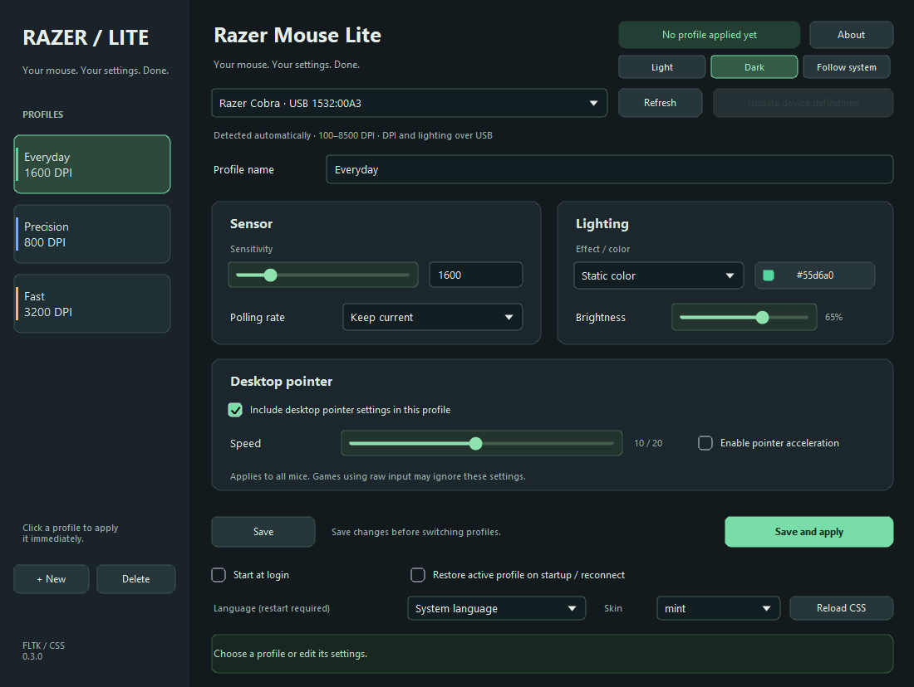
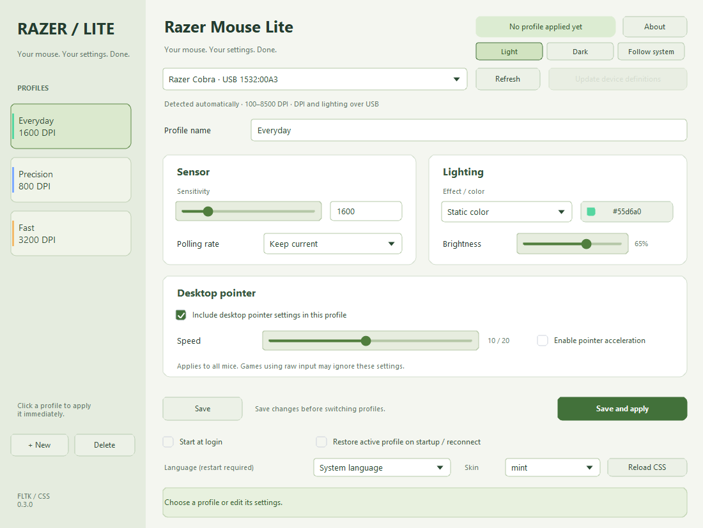

# Using Razer Mouse Lite

Razer Mouse Lite is an independent, unofficial app for adjusting supported Razer
USB mice. It stores profiles locally and communicates through native HID APIs.
No account, Synapse or OpenRazer daemon is required.

## Install and connect

Download a package from [GitHub Releases](https://github.com/hdijkema/razer-mouse-lite/releases).
Windows x64 packages include an installer and a portable ZIP. Extract the entire
ZIP before running `razer-mouse.exe`. Choose the Linux package matching Ubuntu
24.04 x86-64 or Debian 13 amd64; see [Building and Linux setup](BUILDING.md#linux)
for permissions and runtime dependencies.

1. Connect your mouse over USB; it is detected automatically.
2. Choose an existing profile or create one with **New**.
3. Adjust its settings, then select **Save and apply**.

Close other mouse-control software before applying settings so applications do
not overwrite each other's changes. Use the app as your normal user.

## Profiles and settings

| Setting | Behavior |
| --- | --- |
| Sensitivity | One DPI value per profile, applied to both axes. The model determines the supported range. |
| Polling rate | Keep the current rate, or choose 125, 500 or 1000 Hz on supported models. |
| Lighting | Static color, brightness, off or keep current lighting. |
| Desktop pointer | Speed and acceleration, where the operating system permits it. |
| Profiles | Create, edit, save, delete and apply saved profiles. |

**Save** writes a profile without applying it. **Save and apply** writes the
profile and sends its settings to the mouse. Selecting a different saved profile
applies it immediately; save edits before switching. When a command fails, the
app reports the error. Earlier commands may already have taken effect; there is
no automatic hardware rollback.

Macros, button remapping, firmware updates, RGB animation editors and programming
the physical DPI button's stages are outside the current scope.

## Tray and startup

With a working tray, closing the settings window hides it. Reopen it from the
tray and choose **Quit** there to exit. Without tray support, closing exits.
Windows supports a click for the next profile and a double-click for settings.
On Linux, use the profile menu and **Next profile**; gestures depend on the panel.

Starting at login and restoring the active profile are separate opt-in settings.
Restore applies on startup/reconnect when enabled. For portable Windows use,
place the folder in its final location before enabling autostart; after moving
it, turn autostart off and on to update the path. Autostart belongs to the current
user, including after an all-users installation.

Linux tray support needs an AppIndicator-compatible runtime and a desktop
indicator host. The executable also works without a tray.

## Device support

The wired Razer Cobra (`1532:00A3`) is the hardware reference tested on Windows:
100–8500 DPI, static lighting, brightness and 125/500/1000 Hz polling.
Other models have device definitions, but a database entry does not establish
that every feature works on that model. Bluetooth is not supported.

**Update device definitions** downloads this project's converted database from
GitHub only when requested. A failed or invalid download leaves the current
definitions in place. Updating definitions does not apply a profile or send
settings to the mouse; new protocol behavior can still need an application update.

When reporting a device issue, include the model, USB product ID, connection
type, operating system and exact error message.

## Desktop pointer controls

On Windows, desktop pointer settings affect all mice. On X11, optional `xinput`
support adjusts the selected libinput mouse. Wayland manages those settings
through the desktop/compositor, so the corresponding controls are disabled.
DPI, polling and lighting are independent of that restriction. Games using raw
input may ignore desktop pointer settings.

## Appearance and language

Choose **Light**, **Dark** or **Follow system**. Mint, Graphite and Sand skins
have editable light/dark CSS files. **Reload CSS** reads edits without restarting;
invalid CSS retains the last working appearance and shows the error.

The app supports English, Dutch, German, Danish, Norwegian Bokmål, Swedish,
French and Spanish. It follows the system language with English as fallback.
Changing language in settings requires a restart. Your profile names are not
translated.

## Local data and privacy

Profiles are local JSON files. Windows uses
`%LOCALAPPDATA%/MouseLite/MouseLite/profiles.json`; Linux uses
`~/.config/MouseLite/MouseLite/profiles.json`. The historical storage name is
retained across upgrades. Installation and uninstallation preserve profiles.

There is no account, cloud sync, advertising, telemetry or background update
check. The app works offline; the optional device-definition update contacts
GitHub when clicked. Startup and profile restoration are disabled unless enabled
by the user.

Windows builds have been verified locally. Physical Linux mouse testing is
still needed in addition to CI. No macOS build is shipped.

Razer Mouse Lite is not affiliated with or endorsed by Razer. Source code is
[GPL-2.0-or-later](https://github.com/hdijkema/razer-mouse-lite/blob/main/LICENSE).
See [third-party notices](https://github.com/hdijkema/razer-mouse-lite/blob/main/THIRD_PARTY.md)
and [build documentation](BUILDING.md) for dependencies and platform details.
